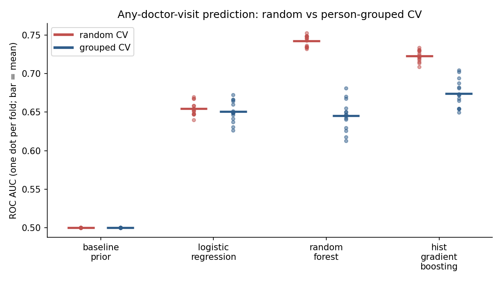

# Doctor-visit prediction: random vs person-grouped cross-validation

A small scikit-learn study of one pointed question: **when the same person
contributes several rows to a dataset, how much does ordinary random
cross-validation overstate how well a model will do on new people?**

The data is an extract of the RAND Health Insurance Experiment (bundled with
`statsmodels`, 20,190 person-year rows). The task is to predict whether a person
made at least one outpatient doctor visit in the year. There is no person ID in
the extract, so rows with identical feature values are treated as one person
(a proxy; limits below).

## Headline finding

Random CV let 98.6% of test rows see their own "person" in training. Grouping by
that proxy removes it. The effect depends sharply on the model:

| Model | AUC, random CV | AUC, grouped CV | Gap |
|---|---|---|---|
| `baseline_prior` (predict the base rate) | 0.500 | 0.500 | 0.000 |
| `logistic_regression` | 0.654 | 0.651 | 0.004 |
| `random_forest` (deep trees) | 0.742 | 0.645 | **0.097** |
| `hist_gradient_boosting` | 0.723 | 0.674 | 0.049 |

*5-fold CV x 3 repeats (15 folds per cell), seed 20261101. AUC SD across folds is
0.007 to 0.019.*

- **Random CV picks the wrong winner.** It ranks the random forest first
  (0.742). Under grouped CV it is the weakest real model, and no better than
  logistic regression (paired difference -0.005 +/- 0.018; ahead in 6/15 folds).
- **The forest's probabilities get worse than useless.** Grouped log loss is 0.656
  against 0.621 for just predicting the base rate. It is confident about people
  it has effectively memorised and wrong about new ones.
- **Logistic regression barely moves** (gap 0.004). It has too little capacity to
  memorise, so its random-CV score was already honest.
- **Gradient boosting keeps a real but modest edge** under grouped CV: +0.024 AUC
  over logistic regression (SD 0.016, higher in 14/15 folds). That edge is about
  a third of what random CV showed (+0.069).
- **Absolute predictive power is low** (best honest AUC about 0.67). These nine
  features describe the insurance plan and general health, not who goes to the doctor.



## Reproduce it

```bash
git clone https://github.com/DefinitelyScott/doctor-visit-prediction-random-vs-grouped-cross-validation.git
cd doctor-visit-prediction-random-vs-grouped-cross-validation
python3 -m venv .venv
.venv/bin/python -m pip install -r requirements.txt

.venv/bin/python run_experiment.py   # about 70 s; prints every table above, writes outputs/
.venv/bin/python -m pytest -q        # 24 tests
```

`outputs/` (fold-level CSV and the figure) is regenerated by the script and is
git-ignored; `docs/auc_random_vs_grouped.png` is a committed copy of that figure
for this README.

## How it works

- `data.py` loads and validates the data, builds the target `any_visit`
  (`mdvis > 0`), and builds person-proxy groups (identical feature rows).
- `models.py` defines the four models. `evaluate.py` runs both CV schemes on the
  same seeds (`StratifiedKFold` vs `StratifiedGroupKFold`), measures leakage
  directly, and computes fold-paired differences. `report.py` prints and plots.

## Limitations

- **The groups are a proxy, not person IDs.** Distinct people with identical
  features are merged into one group (this makes grouped CV stricter). A person
  whose health variables changed across years is split into several groups, so
  some leakage can remain (this makes grouped CV still slightly optimistic).
  The true leakage effect is therefore at least as large as shown, most likely.
- One dataset, one target, nine features, no hyperparameter tuning. The size of
  the gap for each model should not be read as a general property of that model
  class; the direction (flexible models gain most from leakage) is the claim.
- Random and grouped schemes use different splits, so their difference is not
  fold-paired. Within a scheme, all models share identical folds.
- The study is about evaluation, not about health policy. Nothing here is a
  causal claim about insurance and doctor visits.

## Data

`statsmodels.datasets.randhie`, the RAND Health Insurance Experiment extract
shipped with the `statsmodels` package (BSD-licensed). See the dataset notes in
`statsmodels` for its original source and variable definitions.
